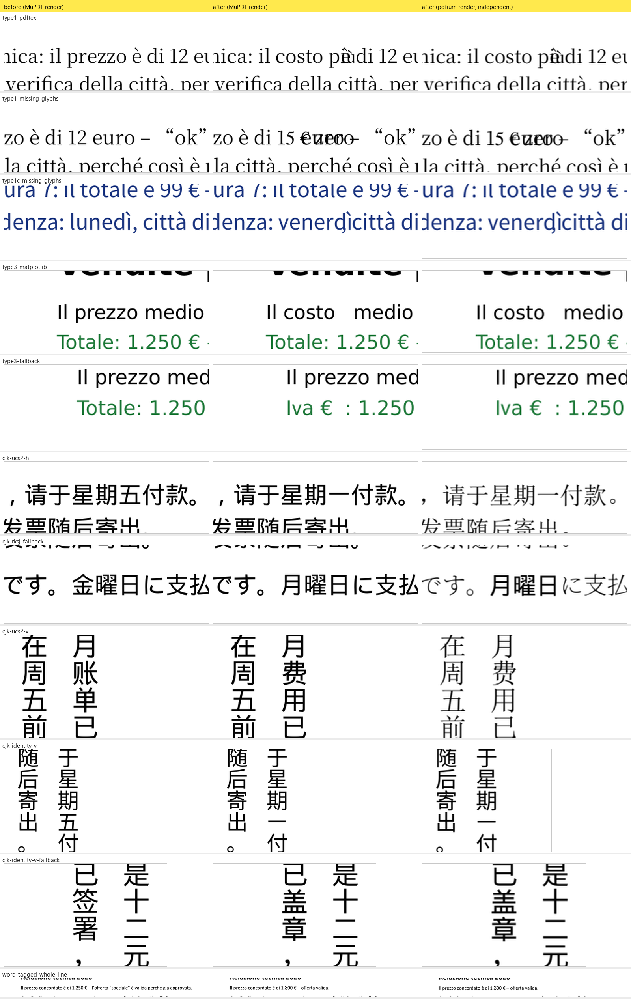

# Prototype: MuPDF.js as the only PDF engine

A throwaway prototype that answers one question before the rewrite: can
`lib/mupdf.js` (MuPDF 1.27.0, WebAssembly) on its own do everything PDF
Editor's export needs, so that pdf.js, pdf-lib and fontkit can go? The risky
part was writing replacement text in the PDF's **original embedded font**.

**Verdict: GO.** All 39 test cases pass in Node 22 and in a Chrome Web
Worker, and an independent engine (pdfium, Chrome's PDF engine) agrees on
all 39 saved files. The second round (15 cases, a 220-page benchmark) covered
the gaps the first one left open: tagged PDFs, Type1 and Type1C fonts, Type3
fonts, vertical CJK and non-Identity CMaps, and memory on a big document.
All of them now work, after six fixes in `src/core.mjs`
([what changed](#what-the-second-round-changed-in-srccoremjs)). The
conditions and the remaining gaps are listed under
[Recommendation](#recommendation).

Nothing outside this folder was changed (`index.html` and `lib/` are untouched).




## How to run

```bash
node prototypes/mupdf-text/run-node.mjs
```

```bash
python -I prototypes/mupdf-text/verify_pdfium.py
```

```bash
node prototypes/mupdf-text/experiments.mjs
```

```bash
python -I prototypes/mupdf-text/fixtures/src/make_large.py
```

```bash
node prototypes/mupdf-text/bench-node.mjs
```

```bash
python -m http.server 8793
```

The first command runs the whole matrix in Node and writes
`out/<case>.pdf`, before/after PNG crops and `out/results-node.json`. Add
`--subset=none` or `--subset=all` to try the other font-subsetting modes, or
pass case ids to run only those. The second re-checks the saved files with
pdfium and pypdf (`pip install pypdfium2 pypdf pillow`), including the
tag-based reading order of tagged files and, if the benchmark ran, its 50
edits; `tools/make_evidence.py` then rebuilds `docs/evidence*.png` from the
crops. The third runs the save-option experiments. The fourth prints the
220-page benchmark file with Chrome (2.9 MB, not committed) and the fifth runs
the benchmark in Node (`out/bench-node.json`). For the browser, start the
server from the repo root and open
`http://localhost:8793/prototypes/mupdf-text/index.html`: *Run test suite*
runs the same matrix in a Web Worker, *Render* shows capability 1, and *Try
your own PDF* edits any file you pick (nothing leaves the browser).
`bench.html` next to it runs the large-document benchmark in the same worker.

Files:

| Path | What |
| --- | --- |
| `src/core.mjs` | All the engine code (render, stext, glyph capture, font analysis, probe, redact, tag, write, save, verify). Takes the `mupdf` module as a parameter, so Node and the worker run the same code. |
| `src/suite.mjs`, `src/cases.mjs` | The test matrix and its pass/fail rule. |
| `src/bench.mjs` | The large-document benchmark (shared by Node and the worker). |
| `src/worker.mjs`, `index.html`, `bench.html` | Browser test page, benchmark page and module Web Worker. |
| `src/tables.mjs` | WinAnsi/MacRoman/Standard encodings and a trimmed Adobe Glyph List (generated by `tools/gen_tables.py`). |
| `run-node.mjs`, `bench-node.mjs`, `experiments.mjs`, `verify_pdfium.py` | Runners and the independent cross-check. |
| `tools/` | Table generator and the evidence-image script. |
| `fixtures/` | Test PDFs; `fixtures/src/` has the scripts that built them. |
| `docs/` | Evidence images and the result JSON files from the final runs (`results-node.json`, `results-pdfium.json`, `bench-node.json`, `bench-worker.json`, `experiments.json`). |

## Fixtures

All fixtures are real producer output or built to mimic one, with Italian text containing `€ ’ “ ” à è é ì ò ù`:

| Fixture | Produced by | Fonts inside |
| --- | --- | --- |
| `chrome-subset.pdf` | Chrome headless print of `fixtures/src/sample.html` (outline added with pypdf) | Type0 Identity-H, CIDFontType2 subsets with ToUnicode: Calibri, Calibri Bold/Italic, Georgia, Consolas |
| `word-winansi.pdf` | Microsoft Word (Office 16) export via COM (`make-word.ps1`) | Type0 subsets + simple TrueType WinAnsi subsets without ToUnicode; Word drew `à ì ù ’` with an embedded DengXian subset; malformed outline (Word bug) |
| `reportlab-form.pdf` | reportlab | Non-embedded standard-14 Helvetica, TrueType subset with a custom (non-standard) encoding, AcroForm text field + checkbox, outline; page 2 is `/Rotate 90` + offset CropBox with upright content |
| `chrome-rotate90-crop.pdf` | pypdf on the Chrome file | `/Rotate 90` + offset CropBox (text reads vertically) |
| `enc-owner-aes256.pdf`, `enc-user-rc4.pdf`, `enc-user-aes128.pdf` | pypdf on the Chrome file | Owner-only AES-256 (opens without a password, print-only permissions); user password `utente` with RC4-128 and AES-128 |
| `fullfont-partial-tounicode.pdf` | hand-built (`make_fullfont.py`) | Fully embedded TrueType (Noto Sans SC, SIL OFL, Latin cut) whose `/ToUnicode` and `/W` list only the glyphs used |
| `cff-subset.pdf` | MuPDF itself (`make_cff.mjs`) | CID-keyed CFF subset (`CIDFontType0C` in FontFile3), as InDesign/Acrobat write it; non-embedded Times-Bold |
| `xobject-tz-link.pdf` | hand-built (`make_xobject.py`) | Text inside a Form XObject drawn under a `1.2` scaling CTM, a link annotation over the edited word, a line with `105 Tz` and `1.5 Tc` |
| `type1-pdftex.pdf` | hand-built like pdfTeX (`make_type1.py`) | Type1 program in `/FontFile` (Length1/2/3, eexec), subset with a tag and `/CharSet`, LaTeX T1 (Cork) `/Differences` naming every code (also glyphs the subset dropped), `/Widths` for the whole range, Flags 4, no `/ToUnicode`, the fi ligature as TeX sets it |
| `type1c-simple.pdf` | hand-built like Distiller/Ghostscript (`make_type1.py`) | Simple font with bare CFF in `/FontFile3 /Subtype /Type1C`, subset, `/WinAnsiEncoding`, `/Widths` 0 for codes the subset lacks, no `/ToUnicode`, blue text |
| `type3-matplotlib.pdf` | matplotlib 3.11 chart (`make_type3.py`, default `pdf.fonttype` 3) | Four Type3 fonts: DejaVu Sans and Bold glyph procedures with `/Differences` and `/ToUnicode`; characters past the first 256 a font uses (€ – “ ” ’) go into a second Type3 dict of the same face |
| `cjk-reportlab.pdf` | reportlab (`make_cjk.py`) | Non-embedded STSong-Light with `/UniGB-UCS2-H` (two lines) and `/UniGB-UCS2-V` (two vertical columns); non-embedded HeiseiMin-W3 with `/90ms-RKSJ-H` (Shift-JIS codes) |
| `cjk-identity-v.pdf` | hand-built like InDesign (`make_cjk.py`) | One embedded TrueType subset (CIDFontType2, CIDToGIDMap Identity, Noto Sans SC) behind two Type0 dicts: `/Identity-V` for two vertical columns, `/Identity-H` for two lines; `/ToUnicode` |
| `large-220p.pdf` (not committed) | Chrome headless print (`make_large.py`) | 220 A4 pages, 2.9 MB, tagged (struct tree with a ParentTree entry per page), Calibri and Georgia subsets shared by every page, a table per page |

The Chrome (Skia m122) and Word files are **tagged PDFs**: both have a
`/StructTreeRoot`, `/MarkInfo /Marked true` and an MCID on every text run, so
16 of the 39 cases edit tagged pages.

To rebuild them: print `fixtures/src/sample.html` with
`chrome --headless=new --no-pdf-header-footer --print-to-pdf=<path>/chrome-subset.pdf file:///<path>/sample.html`,
run `fixtures/src/make-word.ps1` (needs Word), then `make_fixtures.py`,
`make_fullfont.py`, `make_xobject.py`, `make_type1.py`, `make_type3.py`,
`make_cjk.py`, `make_large.py` (Python, reportlab/pypdf/fontTools/matplotlib;
the last one needs Chrome) and `node fixtures/src/make_cff.mjs`.

## What was checked for every case

After editing and saving, the output is reopened (without a password) and:

- the old word is gone (one fewer occurrence in the extracted page text);
- the replacement extracts as the exact Unicode string;
- the words before and after it on the same line are still there;
- baseline origin, font size, direction and colour equal the original (Δ < 0.01 pt);
- every character comes from the font the plan chose, and characters drawn
  with the original font use **the same glyph id** as that character
  elsewhere in the saved file;
- **0 pixels change** outside the old and new text boxes (whole page rendered at 2×);
- page count, outline items, AcroForm fields, widget values and links are unchanged;
- on tagged pages: the structure tree grows by exactly one `/Span` per edit,
  the page shows no more untagged text than before, and each replacement is
  marked with a new MCID whose `/Span` hangs under the element that held the
  old word.

`verify_pdfium.py` repeats the text and pixel checks with pdfium, the
encryption, outline and AcroForm checks with pypdf, and for tagged files
rebuilds the reading order screen readers use (structure tree in `/K` order,
each MCID replaced by the text pdfium finds under it): the replacement must
be in it, the old word gone from it, and no untagged text added.

## Results by capability

### 1. Render in a Web Worker: works

```js
// src/worker.mjs is a module worker (new Worker(url, { type: "module" }))
const mupdf = await import("../../../lib/mupdf.js");
const doc = mupdf.Document.openDocument(bytes, "application/pdf");
const page = doc.loadPage(0);
const m = mupdf.Matrix.scale(1.5, 1.5);
const r = mupdf.Rect.transform(page.getBounds(), m);
const pix = new mupdf.Pixmap(mupdf.ColorSpace.DeviceRGB,
  [Math.floor(r[0]), Math.floor(r[1]), Math.ceil(r[2]), Math.ceil(r[3])], true);
pix.clear(255); // opaque white, so premultiplied alpha == straight alpha
const dev = new mupdf.DrawDevice(mupdf.Matrix.identity, pix);
page.run(dev, m);
dev.close();
const rgba = new Uint8ClampedArray(pix.getPixels()); // copy out of the wasm heap
const bitmap = await createImageBitmap(new ImageData(rgba, pix.getWidth(), pix.getHeight()));
postMessage({ bitmap }, [bitmap]); // transferred, zero-copy
```

Wait for the worker's own "ready" message before posting work: with
top-level `await` a message can arrive before `onmessage` is attached.

### 2. Structured text with font, size, colour and quads: works

`toStructuredText().walk()` gives each character's font object (name keeps
the subset tag, e.g. `BAAAAA+Calibri`, plus bold/italic/serif/mono flags),
size, sRGB colour, origin and quad. A custom `Device` adds what stext lacks:
the glyph id, the full glyph matrix (size, `Tz`, rise, rotation, Form XObject
CTM) and the real colour space (Gray/RGB/CMYK).

```js
page.toStructuredText("preserve-whitespace").walk({
  onChar(c, origin, font, size, quad, color) { /* font.getName(), size, [r,g,b], quad */ },
});
const dev = new mupdf.Device({
  fillText(text, ctm, colorspace, color, alpha) {
    text.walk({ showGlyph(font, trm, gid, unicode) {
      const m = mupdf.Matrix.concat(trm, ctm); // glyph matrix in page space
    } });
  },
});
page.runPageContents(dev, mupdf.Matrix.identity);
dev.close();
```

Gotcha: MuPDF stores font names in a 32-byte buffer, so names longer than 31
characters come back truncated; match `/BaseFont` by prefix.

### 3. Remove a word with a Redact annotation: works, with two caveats

```js
const annot = page.createAnnotation("Redact");
annot.setQuadPoints(chars.map((ch) => shrinkQuad(ch.quad))); // inner 70 % × 50 %
page.applyRedactions(false, 0, 0, 0); // no black box, keep images and line art
```

- Shrinking the char quads keeps kerned neighbours safe (neighbours were
  intact in all 39 cases). In vertical text this needs MuPDF's quads
  corrected first (capability 10).
- **Redaction also deletes link annotations that touch the area.** That is
  right for privacy and wrong for an editor; `replaceText` snapshots
  `page.getLinks()` and re-creates any lost link with `page.createLink()`.
- The rest of the line is re-positioned with TJ offsets. MuPDF reads it back
  0.000 pt off; pdfium places it up to 0.05 pt off (0.017 mm), invisible but
  enough to change a few hundred anti-aliased edge pixels in 3 cases. In
  vertical text pdfium applies the offset in the wrong direction, so there
  no offset is left (capability 10).

### 4. Write the replacement in the original embedded font: works

This was the go/no-go item. How `replaceText()` in `src/core.mjs` does it:

1. Find the font dict: walk the page `/Resources/Font` (and Form XObjects) for
   `/BaseFont` (Type3: `/Name`) equal to the stext font name, then **prove** it
   by re-encoding the original word with it and checking the resulting glyph
   ids equal the ones the page actually draws (`fontDictVerified` in the
   results). Only dicts with the same writing mode count (an Identity-H and an
   Identity-V dict often share one program).
2. Unicode → character code, best first: reverse `/ToUnicode`; else
   `/Encoding` + `/Differences` (glyph names through the AGL; Type1, Type1C,
   TrueType and Type3 alike); else, for Identity-H/V TrueType, the embedded
   font's own cmap (CID = GID); for Unicode CMaps (`UniGB-UCS2-H`,
   `UniJIS-UTF16-V`, …) the UTF-16 unit itself. Other CMaps (Shift-JIS, GBK,
   …) are not handled and fall back.
3. **Probe** the candidate codes: graft the font dict into a scratch
   document, draw every code twice, and read back the glyph id, the ink it
   puts down and the advance the PDF widths give it. This rejects glyphs that
   a subset dropped (empty outline or `.notdef`) and codes with no width,
   without touching the user's file.
4. Try, in order: the original dict; other dicts with the same face (Word
   splits one font into a Type0 and a WinAnsi dict); the embedded font the
   document itself used for that character on the same line, same style
   (Word draws `ì` with DengXian). Only then fall back, per character, to the
   built-in Nimbus face matching the style (Helvetica/Times/Courier ×
   bold/italic), then MuPDF's built-in CJK font (`✓` came from there).
   Fallback fonts are added with `doc.addFont()` (Type0 Identity-H with
   ToUnicode, code = `font.encodeCharacter()`).
5. Write one text object at the original baseline: the glyph matrix is taken
   to user space with `invert(page.getTransform())`, split into `Tf` size,
   `Tz` and a unit `Tm`; `Tc` is copied when the original glyph spacing shows
   uniform letter-spacing. The colour uses the original colour space
   (`g`/`rg`/`k`). The page's old content is wrapped in `q … Q` and the new
   text appended. When a newly used code was missing from `/ToUnicode` or
   `/W`, entries are added so every viewer extracts and spaces it right.

```js
const m = mupdf.Matrix.concat(glyph.m, mupdf.Matrix.invert(page.getTransform()));
const sx = Math.hypot(m[0], m[1]), size = Math.hypot(m[2], m[3]);
const tm = [m[0] / sx, m[1] / sx, m[2] / size, m[3] / size, m[4], m[5]];
ops = `q BT 0 0 0 rg ${tm.join(" ")} Tm /F5 ${size} Tf <015d0175…> Tj /FPE1 ${size} Tf <0056> Tj ET Q`;
```

Which font drew each character of the replacement (O = original dict,
S = same face in another dict or the font used on that line, F = fallback):

| Case | Original font | Replacement |
| --- | --- | --- |
| chrome-calibri | Calibri, Type0/CIDFontType2 subset | `O:importo` |
| chrome-specials | Calibri subset | `O:“n` `F:u` `O:ova” è l’€ già perché città` |
| chrome-missing-glyphs | Calibri subset | `O:pi` `F:ù` `O:␠` `F:G` `O:r` `F:öß` `O:e␠` `F:ñ` `O:␠` `F:Ω` `O:␠` `F:✓` (CJK) |
| chrome-georgia / consolas / bold / red | subsets | `O:sa F:b O:ato` · `O:1 F:4 O:9,00` · `F:S O:a F:l O:do` · `F:U O:rgente` (red kept) |
| fullfont-identity-path | full TrueType, partial ToUnicode/W | `O:unitario “ÀÉ” – ñ` (7 ToUnicode + 5 /W entries added) |
| cff-cid-subset | CID-keyed CFF subset | `O:costo € “ok”` |
| word-calibri | Word Type0 subset | `O:importo “è” l’€` |
| word-cambria | Word Type0 subset | `O:l F:u O:ned S:ì` (DengXian, as Word did) |
| rl-helvetica-std14 | non-embedded Helvetica | `O:acconto è “ok” l’€` |
| rl-arial-custom-enc | reportlab custom-encoded TrueType subset | `O:Bianchi & C. più` |
| xobject-cm-link | Helvetica inside a scaled Form XObject | `O:saldo €` at 14.4 pt (12 × 1.2), link kept |
| tz-tc-spacing | Helvetica, `105 Tz 1.5 Tc` | `O:stretto`, written with `11 Tf 105 Tz 1.5 Tc` |
| type1-pdftex / -missing-glyphs / -ligature | pdfTeX-style Type1 in `/FontFile`, no ToUnicode | `O:costo pi F:ù` · `O:1 F:5 O:␠ F:€ O:␠zero` · `O:fine` (from *veri**fi**ca*) |
| type1c-simple / -missing-glyphs | simple Type1C in `/FontFile3`, WinAnsi | `O:saldo €` · `F:v O:enerdì` (Helvetica, see the sans fix) |
| type3-matplotlib / -fallback / -bold-chart | matplotlib Type3 (DejaVu glyph procedures) | `O:costo` · `O:I F:v O:a␠ S:€` (€ from the second Type3 dict) · `F:R O:ica F:v O:i ; F:R O:oma` |
| cjk-ucs2-h / cjk-ucs2-v | non-embedded STSong-Light, UniGB-UCS2-H / -V | `O:星期一` · `O:费用` + rest of the column `已结清，谢谢合作。` rewritten |
| cjk-rksj-fallback | non-embedded HeiseiMin-W3, 90ms-RKSJ-H | `F:月曜日` (Droid Sans Fallback, the built-in CJK font) |
| cjk-identity-v / -v-fallback | embedded subset, Identity-V (vertical) | `O:星期 F:一` + `付款。` · `F:盖章` + `，发票随后寄出。`, fallback through an Identity-V twin |
| cjk-identity-h-sibling | the same subset, Identity-H | `F:负责 O:人` (the Identity-V sibling is not used for horizontal text) |
| word-tagged-whole-line | Word Calibri, tagged | 51-character line: `O:Il prezzo concordato è di 1.` `F:3` `O:00 € – o` `F:ff` `O:erta valida.` |

So `€ ’ “ ” à è é ì ò ù` survive in the original font whenever the subset
contains them, and in every case they extract correctly in MuPDF and pdfium.
**A subset only contains the glyphs the document used**: a lowercase `u`,
`b` or `l` missing from a short document's subset is common, so per-character
fallback will happen in real files. That is a property of subset fonts, not of
MuPDF; pdf-lib + fontkit could not do better.

### 5. Rotation, CropBox and passwords: works

- `/Rotate 90` with upright content (reportlab p. 2) and `/Rotate 90` +
  offset CropBox with vertical text: baseline Δ 0, direction kept.
- Owner-only AES-256 opens with no password (`needsPassword()` false);
  RC4-128 and AES-128 user passwords via `authenticatePassword("utente")`
  (returns 2 for the user password, 4 for the owner password, 0 if wrong).
- AES-256 key derivation costs 27–98 ms on open; the others are under 2 ms.

### 6. Save with garbage/compress: works

```js
subsetFallbackFonts(mupdf, doc); // shrink only the fonts we added
const out = doc.saveToBuffer("garbage=compact,compress=yes,decrypt=yes").asUint8Array().slice();
```

- Old word gone and new text extractable, in MuPDF and pdfium.
- Outline kept: Chrome 3 → 3, Word 2 → 2 (MuPDF repairs Word's malformed
  outline on read and writes a clean one), reportlab 2 → 2.
- AcroForm kept: 2 → 2 fields, values `Mario` / `Yes` unchanged.
- Save options (`experiments.mjs`): without `decrypt` the original
  encryption and passwords are kept; `encrypt=aes-256,user-password=…`
  re-encrypts (a free "protect" feature); `incremental` appends changes and
  leaves the original bytes as a prefix (useful for signed files, **but the
  old word stays recoverable from the earlier revision**).

**Font subsetting.** `doc.addFont()` embeds a fallback face whole
(Nimbus 30–45 KB; the CJK font 1.7 MB). Three modes were measured:

| Case | Input | No subsetting | Fallback fonts only (default) | `subsetFonts()` on all |
| --- | ---: | ---: | ---: | ---: |
| chrome-calibri (no fallback) | 73,485 | 72,627 | 72,627 | 66,854 |
| chrome-specials (Helvetica) | 73,485 | 105,523 | 82,466 | 76,693 |
| chrome-missing-glyphs (+CJK) | 73,485 | 1,808,179 | 90,792 | 85,019 |
| word-cambria | 220,661 | 266,136 | 230,658 | 223,021 |
| rl-helvetica-std14 | 48,766 | 48,166 | 48,166 | 29,583 |

`subsetFonts()` on the whole document also re-subsets the **original**
fonts. MuPDF still renders them identically, but pdfium renders reportlab's
re-subset Arial with sub-pixel differences on every line (1,171 pixels, 0.1 pt),
and Word's fonts log "cannot be both symbolic and non-symbolic. Skipping
subsetting". So the default subsets only the fallback faces, in a scratch
document, and swaps the grafted subset into the pages (`subsetFallbackFonts`);
original font bytes are never touched.

### 7. Tagged PDFs: works, after a fix (the replacement is now tagged)

Chrome and Word export tagged PDFs by default, so this is the common case,
not a corner one. What MuPDF does on its own:

- **Nothing breaks.** Redaction keeps every `BDC`/`EMC` and every MCID
  (14 of 14 on the Chrome page, 14 of 14 on the Word page), and the
  structure tree and ParentTree survive `garbage=compact` unchanged
  (24 elements in the Chrome file, 11 in the Word file).
- The old word leaves its tag: pdfium reads MCID 1 back as
  "Il concordato è di 1.250 €…".
- **But the replacement was untagged.** It is appended to the content stream
  outside any marked content, so it is not in the structure tree: pdfium
  lists it as an untagged text object (Chrome 0 → 1, Word 0 → 4 for
  "lunedì" written in three fonts). Screen readers, Acrobat's Read Out Loud
  and Reflow, and PDF/UA checkers follow the tags and would skip it or flag
  it. MuPDF's own structured text even files it under the last paragraph of
  the page (Word `P#5`).

So `replaceText` now tags it: before and after redacting, a small
content-stream lexer (`markedContent`) collects the bytes each MCID shows;
the MCID that lost bytes is the one that held the word. The new text is
wrapped in `/Span <</MCID n>> BDC … EMC` with a fresh MCID, and a `/Span`
structure element (`/P` = the element that held the word, `/Pg` = the page,
`/K n`) is inserted into that element's `/K` right after the old MCID and
registered in the page's ParentTree.

Result on all 16 tagged cases: one more structure element per edit
(Chrome 24 → 25, Word 11 → 12, three edits 24 → 27), no untagged text added
(0 → 0), and pdfium finds the replacement in the tag-based reading order
under `Document/P/Span` (Word) or `Document/P/NonStruct/Span` (Chrome).

**Reading order follows the granularity of the edit.** A word replaced in
the middle of a line is read at the end of that element, because the old
MCID still holds the rest of the line: tag order is
"…è valida perché già approvata. **importo** Gentile cliente…". When the
whole line is replaced, as the editor should do anyway, the order is exact:
"Relazione tecnica 2026 **Il prezzo concordato è di 1.300 € – offerta
valida.** Gentile cliente…" (`word-tagged-whole-line`, and `chrome-whole-line`
on the Chrome file). Untagged extraction still sees the new text at the end
of the content stream, as before.

Cost: 2.1–2.4 ms per edit in Node and 5–8 ms in the worker on the 220-page
Chrome file (two lexer passes over a 43 KB page). Not handled: a word inside
a Form XObject's marked content (the edit then reports
`tag.untagged`, and the text stays untagged as before); `/Lang` and
`/ActualText` are not copied to the new `/Span`.

### 8. Type1 (`FontFile`) and Type1C (`FontFile3`) simple fonts: work

No new code path was needed: the simple-font path (codes from `/Encoding` and
`/Differences` through the AGL, probe in a scratch document) handles both.

- **pdfTeX-style Type1** (`type1-pdftex.pdf`, no ToUnicode, Cork
  `/Differences` naming every code): "costo più" is written in the original
  program except `ù`. pdfTeX names every code of its encoding and gives it a
  width even when the subset dropped the glyph; the probe sees `.notdef` with
  no ink for `5`, `ù`, and falls back per character. Words with the TeX fi
  ligature (`verifica` → `fine`) edit fine; so do Chrome words whose
  ligatures carry `/ActualText` (`offerta`, `verificare`, checked by hand).
- **Simple Type1C** (`type1c-simple.pdf`, WinAnsi, no ToUnicode): "saldo €"
  comes entirely from the original CFF, `€` included (code 0x80).
- **Bug found and fixed:** MuPDF reports every bare CFF or Type1 program as
  serif (it only reads the OS/2 class of TrueType/OpenType fonts), so a sans
  Type1C font fell back to Times. `styleOf` now trusts a sans name first
  (sans, gothic, arial, helvetica, …): the missing `v` of Noto Sans T1C now
  comes from Nimbus Sans.

### 9. Type3 fonts: work, in the original glyphs when they exist

Before, Type3 was marked "not handled" and every character fell back to
Nimbus. That was already clean (no crash, colour, size and baseline kept,
every check green), but needless: a Type3 glyph is a content procedure that
the probe can draw like any other glyph. Type3 dicts now go through the
simple-font path (codes from `/Differences` or `/ToUnicode`, glyphs that put
no ink down are rejected; MuPDF names a Type3 font by `/Name`, or
"Unnamed-T3"). On the matplotlib chart, "costo" is written with the original
DejaVu Sans procedures; in "Iva €" the `v` that the subset lacks falls back
to Helvetica and `€` comes from matplotlib's second Type3 dict of the same
face. Bold titles, axis labels and the green text all keep their style.
Not tested: bitmap Type3 fonts (old pdfTeX PK fonts); their glyph names are
often not in the AGL, so their text cannot even be found by search.

### 10. Vertical CJK and non-Identity CMaps: work, after four fixes

What happened first: horizontal text with a non-Identity CMap already fell
back cleanly (`UniGB-UCS2-H` and `90ms-RKSJ-H` → Droid Sans Fallback), but
**vertical text could not be edited at all**: a vertical word was "not
found", a single character "could not be matched to a drawn glyph" (the
document was left untouched). The causes, all in MuPDF 1.27's structured
text or in pdfium, and the fixes:

1. **MuPDF puts every character of vertical text on a line of its own.**
   `extractLines` now joins consecutive `wmode 1` lines that continue each
   other down the same column.
2. **MuPDF's quads for vertical text sit 0.88 em too far down the column**:
   they start at the glyph origin (pen − v) instead of the pen. pdfium's
   character boxes agree with the ink, not with MuPDF (first glyph at y 82–98,
   MuPDF says 96–112). Redacting with those quads removed the character
   after the word (付 vanished). `extractLines` moves them back by v.y (the
   DW2 default 880/1000 em) and keeps the glyph origin for matching.
3. **Writing vertically.** The text is written with the original dict when it
   is Identity-V or a Unicode CMap ending in `-V`, from the pen position
   (glyph origin + v, with v from `/W`, `/DW`, `/DW2`, `/W2`). Fallback
   characters go through an Identity-V twin of the fallback font (same
   descendant font, subset at save like the horizontal one), so they stack
   in the column instead of running across it.
4. **pdfium applies `TJ` offsets horizontally in vertical text.** After
   removing a word in the middle of a column, MuPDF keeps the rest of the
   column in place with `[3000] TJ`; the spec subtracts that from the
   vertical coordinate and MuPDF renders it right, but pdfium moves the rest
   48 pt sideways into the next column (3,789 pixels changed). Chrome uses
   pdfium, so `replaceText` now also redacts and rewrites the rest of the
   column after the word (same characters, same fonts): no offset is left.

Also new: **Unicode CMaps use the original font dict** (code = UTF-16 unit;
non-embedded fonts skip the width comparison, since viewers scale their
substitute to `/W`). For the non-embedded STSong-Light this means the
replacement is drawn with the same substitute font as the rest of the line
in every viewer, where an embedded fallback would look different in pdfium.
Shift-JIS (`90ms-RKSJ-H`) and other non-Unicode CMaps still fall back, and do
so cleanly (`F:月曜日`); the built-in CJK font is picked from the CID
ordering (`Japan1` → `ja`), though this wasm build has a single CJK font
(Droid Sans Fallback) for all four.

All six CJK cases pass in MuPDF and pdfium with 0 pixels changed outside the
edits. Limits: the rewritten rest of the column moves if the replacement has
a different length (that is reflow inside the column; it can run past the
column end); the quad correction assumes DW2 880 (true for every font seen);
for non-Identity vertical CMaps the CID of the first glyph is unknown, so
`/W2` is not consulted; Latin fallback characters in a vertical column stand
upright.

### 11. Large documents: memory is flat, after a fix

`bench-node.mjs` and `bench.html` open the 220-page Chrome file (2.9 MB,
tagged), render page 1, make 50 replacements on pages spread from 1 to 220
(`prezzo`, `consegna`, the bold heading `Capitolo`), save, re-open the result
and check every edit, render all 220 pages as thumbnails, then do it all a
second time. All 50 edits are written in the original fonts and tagged;
50/50 verify in MuPDF and in pdfium, also in the tag-based reading order.

**The first run found a leak-like growth:** the wasm heap went from 21.9 MB
to 94.9 MB after 50 edits, 113.9 MB after saving and 236 MB after the second
cycle. It was not a real leak (with a forced JS GC the heap stayed at
94.9 MB over three cycles) but garbage that only JS GC could release:
`probeCodes` loaded a page of its scratch document, and that page wrapper and
a Font wrapper per probed glyph kept the scratch document, with its copy of
the font program, alive after `scratch.destroy()`. Now they are destroyed
explicitly (and `replaceText` drops its page), and the heap does not move:

| WebAssembly heap (high-water mark) | Node 22 | Chrome worker |
| --- | ---: | ---: |
| After init | 21.9 MB | 21.9 MB |
| After 50 edits | 21.9 MB | 21.9 MB |
| After save | 26.4 MB | 26.4 MB |
| After a second open + 50 edits + save + checks | 26.4 MB | 26.4 MB |
| Before the fix, after 50 edits / save / 2nd cycle | 94.9 / 113.9 / 236.3 MB | — |

The wasm heap never shrinks, so these are high-water marks of MuPDF's
allocations. Node's resident size still grows from 71 to 268 MB over the two
cycles: JS strings and arrays waiting for the JS GC, not MuPDF memory.

Timings, 220 pages, median (p95, max) over 50 edits; ranges over two to three runs:

| Step | Node 22 | Chrome worker |
| --- | ---: | ---: |
| Open (2.9 MB, 220 pages) | 4–5 ms (1.2 warm) | 3–15 ms |
| Render page 1 at 1.5× | 27–31 ms cold, 7 warm | 17–23 ms (102 cold) |
| One edit | 20 ms (26–37, 32–69) | 52–59 ms (84–115, 94–197) |
| of which tagging | 2.1–2.4 ms | 4.9–7.8 ms |
| Save 50 edits (garbage=compact, compress) | 85–103 ms | 214–247 ms |
| Output size | 2,912,228 → 2,771,529 bytes | same |
| Re-open and check 50 pages (test only) | 0.36–0.43 s | 0.98–1.16 s |
| Thumbnails of all 220 pages at 0.15× | 0.43–0.45 s | 0.99–1.09 s |

Where an edit's time goes (Node median): structured text 2.9 ms, glyph
capture 2.5, font analysis and probe 5.1, plan 2.9, redaction with tagging
6.0, write 0.1. The worker runs every step about three times slower than
Node in this browser, evenly, so it is wasm speed rather than any one step.

### What the second round changed in `src/core.mjs`

1. Tagged pages: the replacement gets its own MCID and `/Span` under the
   element that held the old word (`markedContent`, `tagReplacement`).
2. Vertical text: lines joined, quads corrected, pen computed from the
   vertical metrics, Identity-V fallback twins, rest of the column rewritten.
3. Unicode CMaps (`Uni*-UCS2/UTF16-H/V`) and Identity-V handled in the
   original font; fallback CJK font chosen by CID ordering.
4. Type3 fonts tried in the original glyph procedures before any fallback.
5. Sans names win over MuPDF's "serif" for bare CFF/Type1 programs.
6. Scratch-document pages and Font wrappers are destroyed explicitly (flat
   memory); stream reading and the lexer use chunked reads and lookup tables.

## Measured payload and timings

Library payload (`lib/`), raw / gzip -9 / brotli 11:

| | Raw | gzip | brotli |
| --- | ---: | ---: | ---: |
| MuPDF (`mupdf.js` + `mupdf-wasm.js` + `.wasm`), already shipped | 9,888 KB | 4,534 KB | 3,463 KB |
| Dropped by the rewrite: pdf.js + worker, pdf-lib, fontkit | 3,402 KB | 1,042 KB | 823 KB |

The rewrite adds nothing and removes 3.4 MB raw (823 KB brotli). The 9.8 MB
`.wasm` is well under Cloudflare Pages' 25 MiB per-file limit.

Timings, median (max) over the 39 cases, A4 pages, two runs each. Node
22.14 on this Windows PC; Chrome 152 module worker in the Claude in-app
browser. The 220-page benchmark is under [capability 11](#11-large-documents-memory-is-flat-after-a-fix).

| Step | Node | Chrome worker |
| --- | ---: | ---: |
| WASM init (cold process / page load) | 30–200 ms | 46–124 ms |
| Open document | 0.1 ms (28, AES-256) | 0.1 ms (25–30, AES-256) |
| Render page at 1.5× (893 × 1263) | 4.7 ms (24–26) | 3.9–4.2 ms (25–42) + ~10 ms to ImageBitmap |
| One replacement (stext + glyphs + font analysis/probe + redact + tag + write) | 13–14 ms (75–79) | 10 ms (64–70) |
| Save (garbage=compact, compress, fallback subsetting) | 2.7–3.0 ms (20) | 1.2–2.2 ms (16–19) |
| Verification (test harness only) | 28–30 ms | 27–30 ms |

The whole 39-case suite runs in 2.5–2.7 s in the worker, including the
verification renders. In the first round 24 cases took about 8 s and an edit
37.5 ms in the same browser; the likely difference is that the probe no
longer leaves scratch documents for the garbage collector (capability 11).
The slowest edit is the 51-character Word line, which probes many codes.

## What does not work, or was not tested

- **No reflow.** A longer replacement overlaps the next word and a shorter
  one leaves a gap (see `docs/evidence.png`). The editor must work at line
  granularity: redact the whole line, rewrite it (`chrome-whole-line` shows a
  55-character line rewritten with nothing to overlap). Mixed-style lines then need one run
  per style; `replaceText` already writes multi-font runs, so this is plumbing.
- **Per-character fallback looks different** (a Helvetica `u` inside Calibri).
  The UI should flag characters that are not in the original font.
- **Reading order.** The new text is appended at the end of the content
  stream, so untagged extraction finds it after the rest of the page. On
  tagged pages it is now in the right structure element, at the end of that
  element unless the whole line was replaced (capability 7).
- **No kerning** in the rewritten text (plain `Tj`); Chrome's original was
  kerned. Word spacing (`Tw`) is not carried over; `Tc` only when uniform.
- **Simple fonts** (Type1, Type1C, TrueType, Type3) cannot gain characters
  outside their encoding, and their `/Widths` range is not extended (such
  characters fall back), even when the glyph is in the program.
- **Vertical text:** the rest of the column is rewritten with every edit; a
  replacement of a different length moves it. Latin fallback characters stand
  upright; `/W2` is ignored for non-Identity vertical CMaps.
- **Non-Unicode CJK CMaps** (Shift-JIS, GBK, Big5, …) always fall back to the
  built-in CJK font, which differs from the substitute other viewers pick.
- **Two MuPDF 1.27 quirks** the code works around and that are worth
  reporting upstream: vertical text gets one stext line per character, and
  its quads are 0.88 em off. And one **pdfium** bug: `TJ` offsets in vertical
  text are applied horizontally.
- **Still not covered:** bitmap Type3 fonts (old pdfTeX PK), marked content
  inside Form XObjects, right-to-left scripts (Arabic, Hebrew), real
  InDesign/Japanese vertical documents (the Identity-V fixture is hand-built),
  LibreOffice's tagged export (not installed here), and documents with large
  images (memory there is dominated by image decoding, not by editing).
- Fallback fonts are written with `/BaseFont /Helvetica` by `addFont()` (the
  program is Nimbus Sans and is embedded); MuPDF reports it back as
  `NimbusSans-Regular`.

## Recommendation

**Still go: make MuPDF the only PDF engine for the rewrite** (Tesseract stays for OCR).
Every capability the export needs works with MuPDF alone, in a Web Worker,
on Chrome, Word, reportlab, matplotlib, pdfTeX-style, Distiller-style, CFF,
CJK and hand-built files, and the output passes an independent engine. The
replacement text reuses the original font, including subsets, Type1, Type1C
and Type3 programs, non-embedded CJK fonts and vertical writing, whenever the
font actually contains the glyph. The five gaps of the first round are
closed; none of them turned into a blocker, but four needed code, so the
rewrite must carry those fixes over.

Conditions for the rewrite:

1. Edit at line (or paragraph) granularity, never single words in place.
   Besides reflow, this is what gives tagged PDFs an exact reading order;
   in vertical text `replaceText` already rewrites the rest of the column.
2. Show the user which characters came from a fallback font.
3. Keep `replaceText`'s safety steps: shrink the redaction quads, restore
   links, prove the font dict by glyph ids, probe codes before writing,
   extend `/ToUnicode` and `/W` when needed, **tag the replacement on tagged
   pages**, and keep the **vertical-text workarounds** (joined lines,
   corrected quads, pen from the vertical metrics, no `TJ` offsets left).
4. Save with `garbage=compact,compress=yes,decrypt=yes` and subset only the
   fallback fonts; do not call `subsetFonts()` on the whole document.
5. **Destroy MuPDF objects explicitly** (pages, scratch documents and their
   pages, Font wrappers, pixmaps); a page wrapper keeps its whole document
   alive until JS GC. Done this way, 50 edits on 220 pages leave the wasm
   heap at 22–26 MB; left to the GC it reached 95–236 MB.
6. Before release, test what is still open: bitmap Type3, marked content in
   Form XObjects, right-to-left scripts, a real InDesign vertical document,
   and image-heavy files.

Fixture note: the Chrome, Word and reportlab files embed subsets of the
Windows fonts used to make them, like any PDF those programs produce;
`fullfont-partial-tounicode.pdf`, `type1-pdftex.pdf`, `type1c-simple.pdf` and
`cjk-identity-v.pdf` embed glyphs of Noto Sans SC / Noto Serif SC (SIL Open
Font License 1.1); `type3-matplotlib.pdf` embeds DejaVu Sans glyphs
(Bitstream Vera license); `cjk-reportlab.pdf` embeds no font.
