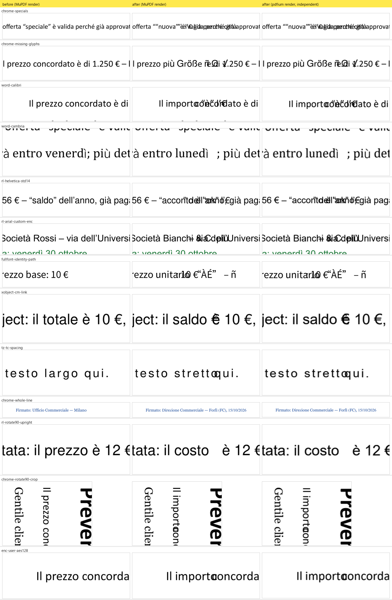

# Prototype: MuPDF.js as the only PDF engine

A throwaway prototype that answers one question before the rewrite: can
`lib/mupdf.js` (MuPDF 1.27.0, WebAssembly) on its own do everything PDF
Editor's export needs, so that pdf.js, pdf-lib and fontkit can go? The risky
part was writing replacement text in the PDF's **original embedded font**.

**Verdict: GO.** All 24 test cases pass in Node 22 and in a Chrome Web
Worker, and an independent engine (pdfium, Chrome's PDF engine) agrees on
all 24 saved files. The conditions and the remaining gaps are listed under
[Recommendation](#recommendation).

Nothing outside this folder was changed (`index.html` and `lib/` are untouched).



## How to run

```bash
node prototypes/mupdf-text/run-node.mjs
```

```bash
python -I prototypes/mupdf-text/verify_pdfium.py
```

```bash
node prototypes/mupdf-text/experiments.mjs
```

```bash
python -m http.server 8793
```

The first command runs the whole matrix in Node and writes
`out/<case>.pdf`, before/after PNG crops and `out/results-node.json`. Add
`--subset=none` or `--subset=all` to try the other font-subsetting modes, or
pass case ids to run only those. The second re-checks the saved files with
pdfium and pypdf (`pip install pypdfium2 pypdf pillow`); `tools/make_evidence.py`
then rebuilds `docs/evidence.png` from the crops. The third runs the
save-option experiments. For the browser, start the server from the repo root
and open `http://localhost:8793/prototypes/mupdf-text/index.html`: *Run test
suite* runs the same matrix in a Web Worker, *Render* shows capability 1, and
*Try your own PDF* edits any file you pick (nothing leaves the browser).

Files:

| Path | What |
| --- | --- |
| `src/core.mjs` | All the engine code (render, stext, glyph capture, font analysis, probe, redact, write, save, verify). Takes the `mupdf` module as a parameter, so Node and the worker run the same code. |
| `src/suite.mjs`, `src/cases.mjs` | The test matrix and its pass/fail rule. |
| `src/worker.mjs`, `index.html` | Browser test page and module Web Worker. |
| `src/tables.mjs` | WinAnsi/MacRoman/Standard encodings and a trimmed Adobe Glyph List (generated by `tools/gen_tables.py`). |
| `run-node.mjs`, `experiments.mjs`, `verify_pdfium.py` | Runners and the independent cross-check. |
| `tools/` | Table generator and the evidence-image script. |
| `fixtures/` | Test PDFs; `fixtures/src/` has the scripts that built them. |
| `docs/` | Evidence image and the result JSON files from the final run. |

## Fixtures

All fixtures are real producer output or built to mimic one, with Italian text containing `€ ’ “ ” à è é ì ò ù`:

| Fixture | Produced by | Fonts inside |
| --- | --- | --- |
| `chrome-subset.pdf` | Chrome headless print of `fixtures/src/sample.html` (outline added with pypdf) | Type0 Identity-H, CIDFontType2 subsets with ToUnicode: Calibri, Calibri Bold/Italic, Georgia, Consolas |
| `word-winansi.pdf` | Microsoft Word (Office 16) export via COM (`make-word.ps1`) | Type0 subsets + simple TrueType WinAnsi subsets without ToUnicode; Word drew `à ì ù ’` with an embedded DengXian subset; malformed outline (Word bug) |
| `reportlab-form.pdf` | reportlab | Non-embedded standard-14 Helvetica, TrueType subset with a custom (non-standard) encoding, AcroForm text field + checkbox, outline; page 2 is `/Rotate 90` + offset CropBox with upright content |
| `chrome-rotate90-crop.pdf` | pypdf on the Chrome file | `/Rotate 90` + offset CropBox (text reads vertically) |
| `enc-owner-aes256.pdf`, `enc-user-rc4.pdf`, `enc-user-aes128.pdf` | pypdf on the Chrome file | Owner-only AES-256 (opens without a password, print-only permissions); user password `utente` with RC4-128 and AES-128 |
| `fullfont-partial-tounicode.pdf` | hand-built (`make_fullfont.py`) | Fully embedded TrueType (Noto Sans SC, SIL OFL, Latin cut) whose `/ToUnicode` and `/W` list only the glyphs used |
| `cff-subset.pdf` | MuPDF itself (`make_cff.mjs`) | CID-keyed CFF subset (`CIDFontType0C` in FontFile3), as InDesign/Acrobat write it; non-embedded Times-Bold |
| `xobject-tz-link.pdf` | hand-built (`make_xobject.py`) | Text inside a Form XObject drawn under a `1.2` scaling CTM, a link annotation over the edited word, a line with `105 Tz` and `1.5 Tc` |

To rebuild them: print `fixtures/src/sample.html` with
`chrome --headless=new --no-pdf-header-footer --print-to-pdf=<path>/chrome-subset.pdf file:///<path>/sample.html`,
run `fixtures/src/make-word.ps1` (needs Word), then `make_fixtures.py`,
`make_fullfont.py`, `make_xobject.py` (Python, reportlab/pypdf/fontTools) and
`node fixtures/src/make_cff.mjs`.

## What was checked for every case

After editing and saving, the output is reopened (without a password) and:

- the old word is gone (one fewer occurrence in the extracted page text);
- the replacement extracts as the exact Unicode string;
- the words before and after it on the same line are still there;
- baseline origin, font size, direction and colour equal the original (Δ < 0.01 pt);
- every character comes from the font the plan chose, and characters drawn
  with the original font use **the same glyph id** as that character
  elsewhere in the saved file;
- **0 pixels change** outside the old and new text boxes (whole page rendered at 2×);
- page count, outline items, AcroForm fields, widget values and links are unchanged.

`verify_pdfium.py` repeats the text and pixel checks with pdfium, and the
encryption, outline and AcroForm checks with pypdf.

## Results by capability

### 1. Render in a Web Worker: works

```js
// src/worker.mjs is a module worker (new Worker(url, { type: "module" }))
const mupdf = await import("../../../lib/mupdf.js");
const doc = mupdf.Document.openDocument(bytes, "application/pdf");
const page = doc.loadPage(0);
const m = mupdf.Matrix.scale(1.5, 1.5);
const r = mupdf.Rect.transform(page.getBounds(), m);
const pix = new mupdf.Pixmap(mupdf.ColorSpace.DeviceRGB,
  [Math.floor(r[0]), Math.floor(r[1]), Math.ceil(r[2]), Math.ceil(r[3])], true);
pix.clear(255); // opaque white, so premultiplied alpha == straight alpha
const dev = new mupdf.DrawDevice(mupdf.Matrix.identity, pix);
page.run(dev, m);
dev.close();
const rgba = new Uint8ClampedArray(pix.getPixels()); // copy out of the wasm heap
const bitmap = await createImageBitmap(new ImageData(rgba, pix.getWidth(), pix.getHeight()));
postMessage({ bitmap }, [bitmap]); // transferred, zero-copy
```

Wait for the worker's own "ready" message before posting work: with
top-level `await` a message can arrive before `onmessage` is attached.

### 2. Structured text with font, size, colour and quads: works

`toStructuredText().walk()` gives each character's font object (name keeps
the subset tag, e.g. `BAAAAA+Calibri`, plus bold/italic/serif/mono flags),
size, sRGB colour, origin and quad. A custom `Device` adds what stext lacks:
the glyph id, the full glyph matrix (size, `Tz`, rise, rotation, Form XObject
CTM) and the real colour space (Gray/RGB/CMYK).

```js
page.toStructuredText("preserve-whitespace").walk({
  onChar(c, origin, font, size, quad, color) { /* font.getName(), size, [r,g,b], quad */ },
});
const dev = new mupdf.Device({
  fillText(text, ctm, colorspace, color, alpha) {
    text.walk({ showGlyph(font, trm, gid, unicode) {
      const m = mupdf.Matrix.concat(trm, ctm); // glyph matrix in page space
    } });
  },
});
page.runPageContents(dev, mupdf.Matrix.identity);
dev.close();
```

Gotcha: MuPDF stores font names in a 32-byte buffer, so names longer than 31
characters come back truncated; match `/BaseFont` by prefix.

### 3. Remove a word with a Redact annotation: works, with two caveats

```js
const annot = page.createAnnotation("Redact");
annot.setQuadPoints(chars.map((ch) => shrinkQuad(ch.quad))); // inner 70 % × 50 %
page.applyRedactions(false, 0, 0, 0); // no black box, keep images and line art
```

- Shrinking the char quads keeps kerned neighbours safe (neighbours were
  intact in all 24 cases).
- **Redaction also deletes link annotations that touch the area.** That is
  right for privacy and wrong for an editor; `replaceText` snapshots
  `page.getLinks()` and re-creates any lost link with `page.createLink()`.
- The rest of the line is re-positioned with TJ offsets. MuPDF reads it back
  0.000 pt off; pdfium places it up to 0.05 pt off (0.017 mm), invisible but
  enough to change a few hundred anti-aliased edge pixels in 3 cases.

### 4. Write the replacement in the original embedded font: works

This was the go/no-go item. How `replaceText()` in `src/core.mjs` does it:

1. Find the font dict: walk the page `/Resources/Font` (and Form XObjects) for
   `/BaseFont` equal to the stext font name, then **prove** it by re-encoding
   the original word with it and checking the resulting glyph ids equal the
   ones the page actually draws (`fontDictVerified` in the results).
2. Unicode → character code, best first: reverse `/ToUnicode`; else
   `/Encoding` + `/Differences` (glyph names through the AGL); else, for
   Identity-H TrueType, the embedded font's own cmap (CID = GID).
3. **Probe** the candidate codes: graft the font dict into a scratch
   document, draw every code twice, and read back the glyph id, the ink it
   puts down and the advance the PDF widths give it. This rejects glyphs that
   a subset dropped (empty outline or `.notdef`) and codes with no width,
   without touching the user's file.
4. Try, in order: the original dict; other dicts with the same face (Word
   splits one font into a Type0 and a WinAnsi dict); the embedded font the
   document itself used for that character on the same line, same style
   (Word draws `ì` with DengXian). Only then fall back, per character, to the
   built-in Nimbus face matching the style (Helvetica/Times/Courier ×
   bold/italic), then MuPDF's built-in CJK font (`✓` came from there).
   Fallback fonts are added with `doc.addFont()` (Type0 Identity-H with
   ToUnicode, code = `font.encodeCharacter()`).
5. Write one text object at the original baseline: the glyph matrix is taken
   to user space with `invert(page.getTransform())`, split into `Tf` size,
   `Tz` and a unit `Tm`; `Tc` is copied when the original glyph spacing shows
   uniform letter-spacing. The colour uses the original colour space
   (`g`/`rg`/`k`). The page's old content is wrapped in `q … Q` and the new
   text appended. When a newly used code was missing from `/ToUnicode` or
   `/W`, entries are added so every viewer extracts and spaces it right.

```js
const m = mupdf.Matrix.concat(glyph.m, mupdf.Matrix.invert(page.getTransform()));
const sx = Math.hypot(m[0], m[1]), size = Math.hypot(m[2], m[3]);
const tm = [m[0] / sx, m[1] / sx, m[2] / size, m[3] / size, m[4], m[5]];
ops = `q BT 0 0 0 rg ${tm.join(" ")} Tm /F5 ${size} Tf <015d0175…> Tj /FPE1 ${size} Tf <0056> Tj ET Q`;
```

Which font drew each character of the replacement (O = original dict,
S = same face in another dict or the font used on that line, F = fallback):

| Case | Original font | Replacement |
| --- | --- | --- |
| chrome-calibri | Calibri, Type0/CIDFontType2 subset | `O:importo` |
| chrome-specials | Calibri subset | `O:“n` `F:u` `O:ova” è l’€ già perché città` |
| chrome-missing-glyphs | Calibri subset | `O:pi` `F:ù` `O:␠` `F:G` `O:r` `F:öß` `O:e␠` `F:ñ` `O:␠` `F:Ω` `O:␠` `F:✓` (CJK) |
| chrome-georgia / consolas / bold / red | subsets | `O:sa F:b O:ato` · `O:1 F:4 O:9,00` · `F:S O:a F:l O:do` · `F:U O:rgente` (red kept) |
| fullfont-identity-path | full TrueType, partial ToUnicode/W | `O:unitario “ÀÉ” – ñ` (7 ToUnicode + 5 /W entries added) |
| cff-cid-subset | CID-keyed CFF subset | `O:costo € “ok”` |
| word-calibri | Word Type0 subset | `O:importo “è” l’€` |
| word-cambria | Word Type0 subset | `O:l F:u O:ned S:ì` (DengXian, as Word did) |
| rl-helvetica-std14 | non-embedded Helvetica | `O:acconto è “ok” l’€` |
| rl-arial-custom-enc | reportlab custom-encoded TrueType subset | `O:Bianchi & C. più` |
| xobject-cm-link | Helvetica inside a scaled Form XObject | `O:saldo €` at 14.4 pt (12 × 1.2), link kept |
| tz-tc-spacing | Helvetica, `105 Tz 1.5 Tc` | `O:stretto`, written with `11 Tf 105 Tz 1.5 Tc` |

So `€ ’ “ ” à è é ì ò ù` survive in the original font whenever the subset
contains them, and in every case they extract correctly in MuPDF and pdfium.
**A subset only contains the glyphs the document used**: a lowercase `u`,
`b` or `l` missing from a short document's subset is common, so per-character
fallback will happen in real files. That is a property of subset fonts, not of
MuPDF; pdf-lib + fontkit could not do better.

### 5. Rotation, CropBox and passwords: works

- `/Rotate 90` with upright content (reportlab p. 2) and `/Rotate 90` +
  offset CropBox with vertical text: baseline Δ 0, direction kept.
- Owner-only AES-256 opens with no password (`needsPassword()` false);
  RC4-128 and AES-128 user passwords via `authenticatePassword("utente")`
  (returns 2 for the user password, 4 for the owner password, 0 if wrong).
- AES-256 key derivation costs 27–98 ms on open; the others are under 2 ms.

### 6. Save with garbage/compress: works

```js
subsetFallbackFonts(mupdf, doc); // shrink only the fonts we added
const out = doc.saveToBuffer("garbage=compact,compress=yes,decrypt=yes").asUint8Array().slice();
```

- Old word gone and new text extractable, in MuPDF and pdfium.
- Outline kept: Chrome 3 → 3, Word 2 → 2 (MuPDF repairs Word's malformed
  outline on read and writes a clean one), reportlab 2 → 2.
- AcroForm kept: 2 → 2 fields, values `Mario` / `Yes` unchanged.
- Save options (`experiments.mjs`): without `decrypt` the original
  encryption and passwords are kept; `encrypt=aes-256,user-password=…`
  re-encrypts (a free "protect" feature); `incremental` appends changes and
  leaves the original bytes as a prefix (useful for signed files, **but the
  old word stays recoverable from the earlier revision**).

**Font subsetting.** `doc.addFont()` embeds a fallback face whole
(Nimbus 30–45 KB; the CJK font 1.7 MB). Three modes were measured:

| Case | Input | No subsetting | Fallback fonts only (default) | `subsetFonts()` on all |
| --- | ---: | ---: | ---: | ---: |
| chrome-calibri (no fallback) | 73,485 | 72,627 | 72,627 | 66,854 |
| chrome-specials (Helvetica) | 73,485 | 105,523 | 82,466 | 76,693 |
| chrome-missing-glyphs (+CJK) | 73,485 | 1,808,179 | 90,792 | 85,019 |
| word-cambria | 220,661 | 266,136 | 230,658 | 223,021 |
| rl-helvetica-std14 | 48,766 | 48,166 | 48,166 | 29,583 |

`subsetFonts()` on the whole document also re-subsets the **original**
fonts. MuPDF still renders them identically, but pdfium renders reportlab's
re-subset Arial with sub-pixel differences on every line (1,171 pixels, 0.1 pt),
and Word's fonts log "cannot be both symbolic and non-symbolic. Skipping
subsetting". So the default subsets only the fallback faces, in a scratch
document, and swaps the grafted subset into the pages (`subsetFallbackFonts`);
original font bytes are never touched.

## Measured payload and timings

Library payload (`lib/`), raw / gzip -9 / brotli 11:

| | Raw | gzip | brotli |
| --- | ---: | ---: | ---: |
| MuPDF (`mupdf.js` + `mupdf-wasm.js` + `.wasm`), already shipped | 9,888 KB | 4,534 KB | 3,463 KB |
| Dropped by the rewrite: pdf.js + worker, pdf-lib, fontkit | 3,402 KB | 1,042 KB | 823 KB |

The rewrite adds nothing and removes 3.4 MB raw (823 KB brotli). The 9.8 MB
`.wasm` is well under Cloudflare Pages' 25 MiB per-file limit.

Timings, median (max) over the 24 cases, A4 pages. Node 22.14 on this
Windows PC; Chrome 152 module worker in the Claude in-app browser:

| Step | Node | Chrome worker |
| --- | ---: | ---: |
| WASM init (cold process / page load) | 60–170 ms | 68–79 ms |
| Open document | 0.1 ms (27 ms) | 0.4 ms (68 ms, AES-256) |
| Render page at 1.5× (893 × 1263) | 4.8 ms (21) | 19.9 ms (63) + ~10 ms to ImageBitmap |
| One word replacement (stext + glyphs + font analysis/probe + redact + write) | 14.2 ms (37) | 37.5 ms (106) |
| Save (garbage=compact, compress, fallback subsetting) | 0.9 ms (20) | 3.0 ms (61, CJK subset) |
| Verification (test harness only) | 32 ms | 224 ms |

The whole 24-case suite runs in about 8 s in the worker, including the
verification renders.

## What does not work, or was not tested

- **No reflow.** A longer replacement overlaps the next word and a shorter
  one leaves a gap (see `docs/evidence.png`). The editor must work at line
  granularity: redact the whole line, rewrite it (`chrome-whole-line` shows a
  55-character line rewritten with nothing to overlap). Mixed-style lines then need one run
  per style; `replaceText` already writes multi-font runs, so this is plumbing.
- **Per-character fallback looks different** (a Helvetica `u` inside Calibri).
  The UI should flag characters that are not in the original font.
- **Reading order.** The new text is appended at the end of the content
  stream, so copy/paste, search and screen readers find it after the rest of
  the page. Tagged-PDF structure (`/StructTreeRoot`, MCIDs) is not updated
  and was not tested.
- **No kerning** in the rewritten text (plain `Tj`); Chrome's original was
  kerned. Word spacing (`Tw`) is not carried over; `Tc` only when uniform.
- **Simple fonts** cannot gain characters outside their encoding, and their
  `/Widths` range is not extended (such characters fall back).
- **Not covered:** Type3 fonts, vertical writing (Identity-V), non-Identity
  CMaps such as UniGB-UCS2-H, embedded Type1 (`FontFile`, older LaTeX), and
  memory use on large documents. The code marks the first three as
  "not handled" and falls back.
- Fallback fonts are written with `/BaseFont /Helvetica` by `addFont()` (the
  program is Nimbus Sans and is embedded); MuPDF reports it back as
  `NimbusSans-Regular`.

## Recommendation

**Go: make MuPDF the only PDF engine for the rewrite** (Tesseract stays for OCR).
Every capability the export needs works with MuPDF alone, in a Web Worker,
on Chrome, Word, reportlab, CFF and hand-built files, and the output passes
an independent engine. The replacement text reuses the original embedded
font, including subsets, `€ ’ “ ”` and Italian accents, whenever the font
actually contains the glyph.

Conditions for the rewrite:

1. Edit at line (or paragraph) granularity, never single words in place.
2. Show the user which characters came from a fallback font.
3. Keep `replaceText`'s safety steps: shrink the redaction quads, restore
   links, prove the font dict by glyph ids, probe codes before writing,
   extend `/ToUnicode` and `/W` when needed.
4. Save with `garbage=compact,compress=yes,decrypt=yes` and subset only the
   fallback fonts; do not call `subsetFonts()` on the whole document.
5. Before release, test the gaps above: tagged PDFs, Type3, Type1
   (`FontFile`), vertical CJK and a 200-page document for memory.

Fixture note: the Chrome, Word and reportlab files embed subsets of the
Windows fonts used to make them, like any PDF those programs produce;
`fullfont-partial-tounicode.pdf` embeds a Latin cut of Noto Sans SC
(SIL Open Font License 1.1).
